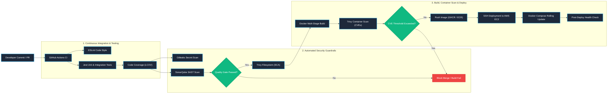
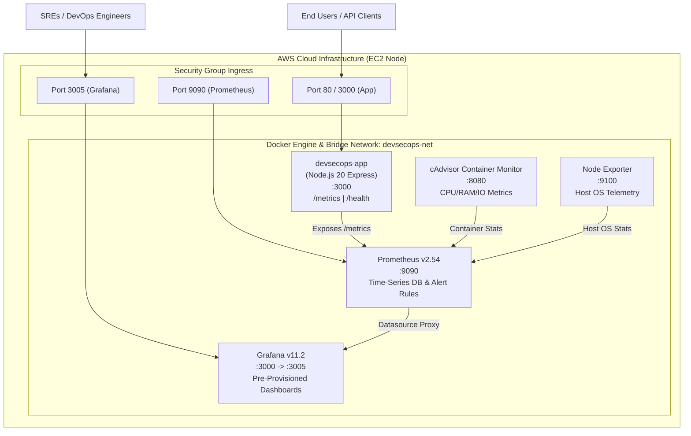

# Cloud-Native DevSecOps Deployment Pipeline

[](#automated-cicd-pipeline)
[](#static-code-analysis-sonarqube)
[](#container-vulnerability-scanning-trivy)
[](#docker-container-hardening)
[](#observability-stack--sre-practices)
[](#infrastructure-as-code-terraform-for-aws-ec2)
[](LICENSE)

An enterprise-grade, cloud-native DevSecOps platform and continuous deployment pipeline. This repository demonstrates end-to-end automation from code commit to production release on AWS EC2, featuring automated security guardrails (SonarQube SAST, Gitleaks, and Trivy CVE scanning) and a comprehensive SRE observability stack (Prometheus, Grafana, cAdvisor, and Node Exporter).

---

## 🎯 Executive Summary & Core Capabilities

- **Automated CI/CD Pipeline:** Engineered a zero-touch pipeline using GitHub Actions that builds, tests, scans, and automatically deploys containerized services to AWS EC2, eliminating manual deployment toil and human error.
- **Automated Security Guardrails:** Embedded shift-left security directly into the pipeline with static code analysis (**SonarQube**), secret detection (**Gitleaks**), software composition analysis (**Trivy FS**), and container image vulnerability gating (**Trivy Image**), preventing vulnerable code and images from reaching production.
- **SRE Observability Stack:** Provisioned a full monitoring ecosystem (**Prometheus, Grafana, cAdvisor, and Node Exporter**) to continuously track container health, golden signals (latency, traffic, errors, saturation), HTTP telemetry, and host resource utilization for high availability.

---

## 🏗️ Architecture Diagrams

### 1. DevSecOps CI/CD Pipeline & Security Guardrails


---

### 2. AWS EC2 Production & Observability Architecture


---

## 🛡️ Security Guardrails Deep Dive

| Layer | Tooling | Scope & Objective | Failure Policy |
| :--- | :--- | :--- | :--- |
| **Secret Scanning** | **Gitleaks** | Scans Git commits & diffs for leaked API keys, tokens, or private credentials | Hard fail on any committed secret |
| **SAST (Static Analysis)** | **SonarQube / SonarCloud** | Analyzes code quality, maintainability, code smells, bug patterns, and OWASP Top 10 | Quality Gate evaluation: Blocks if coverage < 80% or vulnerabilities > 0 |
| **SCA (Dependencies)** | **Trivy Filesystem** | Scans `package-lock.json` and third-party dependencies against Aqua Vulnerability DB | Generates SARIF report; fails on CRITICAL unpatched dependencies |
| **Container Image Scan** | **Trivy Image** | Scans final container image layers, OS packages (Alpine), and system binaries | Rejects images containing HIGH or CRITICAL CVEs |
| **Container Hardening** | **Dockerfile** | Multi-stage build, minimal Alpine Linux base, non-root user `node` (UID 1000), Tini signal handling | Built-in enforcement |
| **Runtime Security** | **Helmet & Express Rate Limit** | Sets Content-Security-Policy, HSTS, X-Content-Type-Options; limits request frequency | 429 Too Many Requests; browser-level XSS mitigation |

---

## 📊 Observability Stack & SRE Best Practices

The observability architecture aligns with the **Google SRE Four Golden Signals**:

### 1. Golden Signals Monitoring
- **Latency:** Measured using `http_request_duration_seconds` histogram buckets (P50, P90, P95, and P99 percentiles).
- **Traffic:** Tracked via `http_requests_total` counter partitioned by route, HTTP method, and status code.
- **Errors:** Real-time 5xx and 4xx rate calculations:
  $$\text{5xx Error Rate} = \left(\frac{\sum \text{rate}(http\_requests\_total\{status\_code=\sim"5.." \}[5m])}{\sum \text{rate}(http\_requests\_total[5m])}\right) \times 100$$
- **Saturation:** Measured at two levels:
  - **Container Level (cAdvisor):** CPU throttling, memory working set, container restarts.
  - **Host Level (Node Exporter):** EC2 system load (load1, load5, load15), RAM utilization, root filesystem disk exhaustion.

### 2. Prometheus Alerting Rules (`monitoring/prometheus/alert_rules.yml`)
- `AppDown`: Triggers critical alert if the application container is unreachable for >1 minute.
- `HighHttpErrorRate`: Triggers warning if HTTP 5xx error rate exceeds 5% over a 5-minute rolling window.
- `HighP99Latency`: Triggers warning if P99 response time exceeds 500ms for >2 minutes.
- `ContainerHighCpuUsage`: Triggers warning if container CPU utilization exceeds 85% for 3 minutes.
- `ContainerHighMemoryUsage`: Triggers warning if container memory usage exceeds 85% of allocated limits.

### 3. Grafana Pre-Provisioned Dashboard
Grafana automatically provisions the Prometheus datasource and loads the custom **DevSecOps SRE Observability Overview** dashboard (`monitoring/grafana/dashboards/devsecops-overview.json`):
- Single-pane-of-glass status tiles for Application Health, RPS, 5xx Error %, and P95 Latency.
- Real-time time-series panels for request volume by status code and route.
- Interactive latency percentiles (P50, P90, P95, P99).
- Real-time container resource telemetry from cAdvisor.
- Host EC2 CPU and memory gauges from Node Exporter.

---

## 📁 Repository Structure

```text
.
├── .github/
│   └── workflows/
│       └── ci-cd.yml             # GitHub Actions CI/CD Pipeline definition
├── monitoring/
│   ├── prometheus/
│   │   ├── prometheus.yml        # Prometheus scrape configurations
│   │   └── alert_rules.yml       # SRE Golden Signal alerting rules
│   └── grafana/
│       ├── provisioning/
│       │   ├── datasources/      # Auto-configured Prometheus datasource
│       │   └── dashboards/       # Auto-loader for dashboards
│       └── dashboards/
│           └── devsecops-overview.json # Custom Grafana dashboard definition
├── terraform/
│   ├── main.tf                   # AWS EC2, Security Groups, and VPC provisioning
│   ├── variables.tf              # Input variable definitions
│   ├── outputs.tf                # Public IP, SSH command, and endpoint URLs
│   ├── terraform.tfvars.example  # Example variable values
│   └── scripts/
│       └── user-data.sh          # Cloud-Init script: Docker, Compose, and dirs
├── src/
│   ├── app.js                    # Express application, security headers, middleware
│   ├── server.js                 # Server startup & graceful shutdown handlers
│   ├── metrics.js                # Prometheus prom-client metrics registry
│   └── routes/
│       ├── health.js             # Liveness & readiness health probes
│       └── api.js                # Secure APIs & SRE simulation endpoints
├── tests/
│   ├── app.test.js               # Application middleware tests
│   ├── health.test.js            # Healthcheck probe tests
│   ├── metrics.test.js           # Prometheus endpoint verification tests
│   └── api.test.js               # API validation & injection prevention tests
├── scripts/
│   ├── deploy.sh                 # Zero-downtime EC2 deployment script
│   ├── setup-ec2.sh              # Standalone EC2 bootstrap script
│   ├── simulate-traffic.sh       # SRE traffic & alert load generator
│   └── local-test.sh             # Local pipeline verification runner
├── Dockerfile                    # Multi-stage hardened production Dockerfile
├── docker-compose.yml            # Complete stack: App, Prometheus, Grafana, cAdvisor, Node Exporter
├── sonar-project.properties      # SonarQube static analysis configuration
├── .gitleaks.toml                # Gitleaks secret scanning rules & allowlists
├── .env.example                  # Environment configuration template
└── package.json                  # Node.js dependencies, scripts & Jest config
```

---

## 🚀 Quickstart & Local Execution

### 1. Run Unit Tests & Code Coverage
```bash
# Install dependencies
npm install

# Run automated test suite with coverage
npm run test:coverage

# Run ESLint guardrail
npm run lint
```

### 2. Run the Full Local DevSecOps Stack
Launch the application and the complete observability stack locally using Docker Compose:
```bash
docker compose up -d --build
```

Verify services:
- **Application Web UI:** [http://localhost:8082](http://localhost:8082)
- **Health Check Endpoint:** [http://localhost:8082/health](http://localhost:8082/health)
- **Prometheus Metrics:** [http://localhost:8082/metrics](http://localhost:8082/metrics)
- **Prometheus Server UI:** [http://localhost:9090](http://localhost:9090)
- **Grafana Dashboard UI:** [http://localhost:3005](http://localhost:3005) (Default login: `admin` / `admin`)
- **cAdvisor Container Telemetry:** [http://localhost:8085](http://localhost:8085)
- **Node Exporter Host Telemetry:** [http://localhost:9100/metrics](http://localhost:9100/metrics)

### 3. Simulate SRE Traffic and Verify Alerts
Use the bundled traffic generator to generate normal requests, latency spikes, and 500 errors to inspect live Prometheus graphs and Grafana visualizations:
```bash
./scripts/simulate-traffic.sh http://localhost:8082
```

---

## ☁️ AWS EC2 Infrastructure Provisioning (Terraform)

To provision the AWS EC2 instance and security infrastructure automatically:

```bash
cd terraform

# Initialize Terraform plugins
terraform init

# Review execution plan
terraform plan

# Apply infrastructure deployment
terraform apply -auto-approve
```

Terraform outputs the EC2 Public IP, connection commands, and web URLs upon completion.

---

## 🔐 GitHub Secrets Configuration

To enable the automated GitHub Actions deployment pipeline, configure the following secrets in **Settings > Secrets and variables > Actions**:

| Secret Name | Description |
| :--- | :--- |
| `AWS_EC2_HOST` | Public IP or DNS of the provisioned AWS EC2 instance |
| `AWS_EC2_USER` | EC2 SSH username (e.g., `ec2-user` for Amazon Linux, `ubuntu` for Ubuntu) |
| `AWS_EC2_SSH_KEY` | Private SSH key (PEM formatted) with access to the EC2 instance |
| `SONAR_TOKEN` | SonarQube / SonarCloud authentication token |
| `SONAR_HOST_URL` | URL of your SonarQube server (e.g., `https://sonarcloud.io`) |

---

## 📈 Post-Deployment Verification & Zero-Downtime Rollout

When a push occurs to `main`:
1. GitHub Actions triggers linting, testing, and coverage verification.
2. SonarQube and Gitleaks enforce code quality and secret policies.
3. Trivy scans repository dependencies for CVEs.
4. Docker Buildx compiles the hardened container image.
5. Trivy scans the container image layers; if vulnerabilities exceed policy, the release is aborted.
6. The container image is published to GitHub Container Registry (`ghcr.io`).
7. GitHub Actions securely connects to AWS EC2 over SSH, transfers configurations, and initiates `docker compose pull && docker compose up -d --remove-orphans`.
8. Automated health polling verifies HTTP 200 on `/health/live`. If health checks fail, container logs are captured and an automated rollback is triggered.

---

## 📄 License
This project is licensed under the MIT License - see the [LICENSE](LICENSE) file for details.
